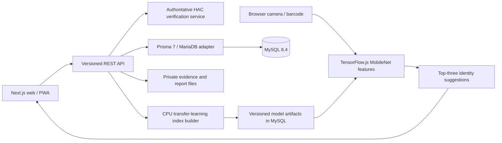

# Architecture

This repository began with only a README. The implementation is a new application under `hac-management-system/web`, rather than a migration of an existing production system. `IMPLEMENTATION_STATUS.md` records the current verified scope and remaining work.

## Runtime components

The Next.js App Router serves the portal and Node.js REST handlers. Server code imports one Prisma client, with MySQL connections managed by `@prisma/adapter-mariadb`. Database constraints and versioned migrations define normalized company, identity, catalogue, certification, inspection, case-management, evidence and AI records.

## Identity and authorization

Passwords use salted scrypt hashes. Opaque session cookies are HttpOnly, SameSite Strict, expire after eight hours and are Secure in production. Only hashes of session tokens are stored. Login attempts are rate limited. Unsafe cookie-authenticated requests validate the application origin.

HAC administrators manage controlled records. Supervisors and auditors access assigned companies; only the assigned inspector or an authorized administrator can change an active inspection. Company users are scoped to their company. API handlers enforce these checks independently of the UI. Audit events exclude credential fields. These are application controls; external database audit protection, MFA, password reset delivery and a full production security assessment remain separate work.

## Certification and inspection

`src/lib/verification.ts` separates identity recognition from official record evaluation. It evaluates brand, variant, manufacturer, barcode, company relationships, effective certificate scope, renewals, suspension/revocation history, explicit restrictions, required licenses, and physical shelf-life. Its result preserves simultaneous outcomes with rules, expected/actual values, references, timestamps and a rule version.

Inspection mutations use optimistic version locking. Observations carry client mutation keys for retry safety. Submission validates required checklist responses and declarations, reconciles verification results, and stores a hashed JSON snapshot. Submitted content is immutable through the application. Reports retain version-specific artifacts and hashes. The first formal review can approve a report or request clarification; a full controlled amendment/revision workflow remains pending.

## Recognition and storage

TensorFlow.js MobileNet extracts visual embeddings from actual images. Training builds a versioned exact nearest-neighbour index using capture-group separation and held-out evaluation. Only an authorized administrator can publish an artifact that passed the implemented gate. Scanner scores express visual similarity, never certification confidence. Missing model access or unavailable weights produces an explicit error rather than an invented prediction. See `AI_MODEL_ARCHITECTURE.md` for the official model URL, metrics, thresholds and unverified field accuracy.

Evidence and generated reports use private filesystem storage outside `public`. Images are decoded and re-encoded with bounded input sizes. Downloads verify SHA-256 and company authorization. AI image files use a separate private uploads directory. Deployments must persist and back up both locations with the database.

## Offline and mobile boundaries

A service worker caches only the public offline fallback and installation assets. It does not cache authenticated pages, APIs or certificate decisions. A browser observation queue encrypts drafts with a non-extractable, in-memory AES-GCM key and reconciles them through authenticated, version-checked API requests. The key does not survive tab reload: this limited queue is not a complete offline inspection package or cross-session draft restoration system.

The web UI is responsive and installable as a PWA. The API can serve a future Flutter client; no Flutter Android application, TFLite pipeline, encrypted mobile evidence store or signed Android build is delivered. Native clients using cookie authentication must send the configured `Origin` and manage the session cookie securely.

## Scaling boundaries

The initial deployment uses one Node service, MySQL and persistent local storage. AI training is synchronous and bounded to 1,500 images; larger workloads require a job worker and suitable vector search. Distributed rate limiting, remote immutable object storage, background scheduling, representative recognition evaluation and deployment monitoring need production-specific integration. Hostinger compatibility depends on the actual plan's Node process, storage, database, request timeout and job support; that plan has not been inspected or deployed.
